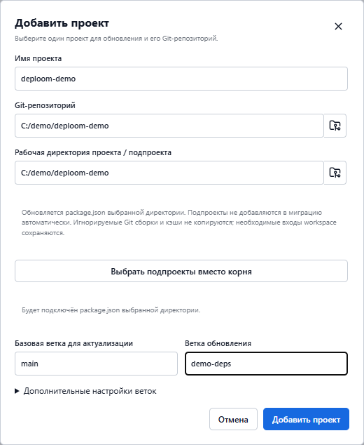
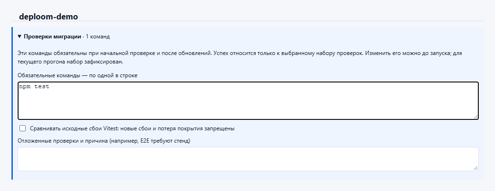
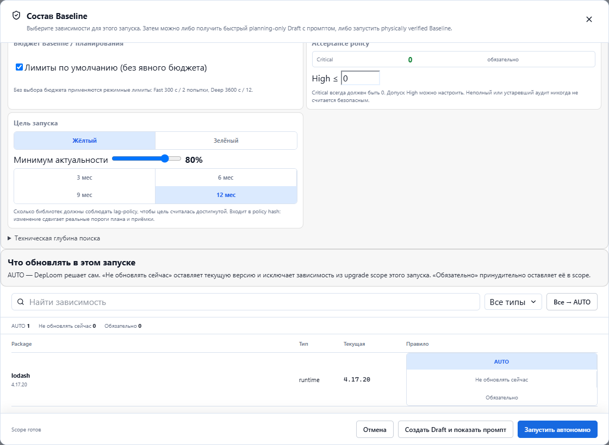
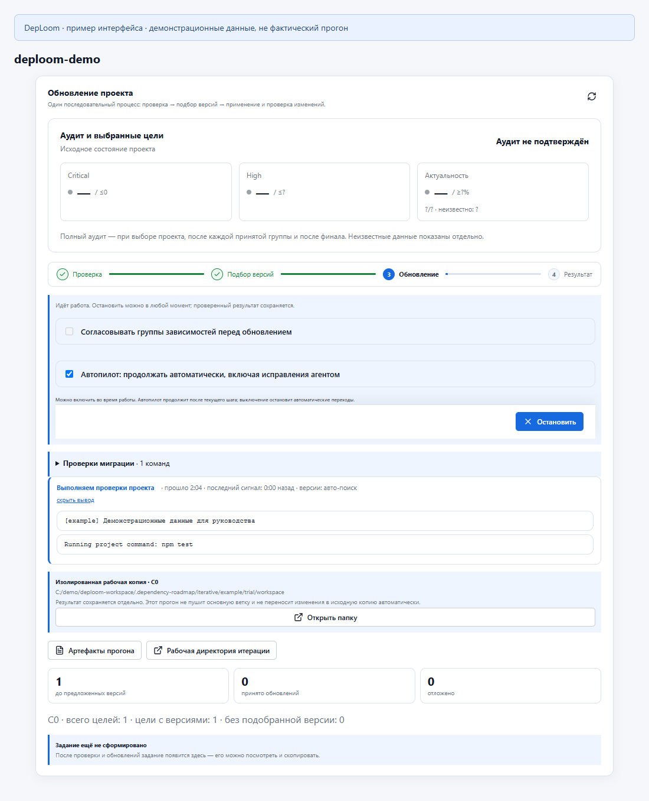
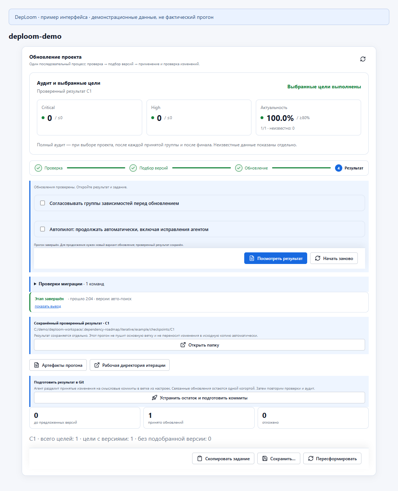
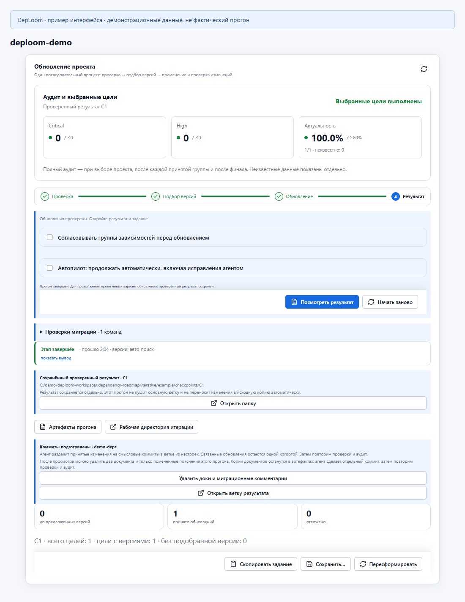

# Как пользоваться DepLoom

DepLoom помогает обновить зависимости проекта: подобрать версии, адаптировать код и проверить результат. Есть два способа работы:

| Путь | Когда выбирать |
| --- | --- |
| **Draft → внешний агент или ручное обновление** | Хотите сами управлять изменениями, работать в привычной IDE или использовать другого агента. |
| **Обновление внутри DepLoom** | Хотите поручить подбор версий, применение изменений и исправления программе. Если автоматический путь не справился, можно перейти к Draft. |

> Скриншоты показывают настоящие компоненты интерфейса с демонстрационными данными. Имена проектов, пути и итоговые цифры — примеры, а не результаты реальной миграции.

## Подключите свой проект

Установите [DepLoom Desktop](https://github.com/AlexanderLevenskikh/deploom/releases), Git, Python 3 и нужные проекту Node.js и пакетный менеджер. Для встроенных исправлений нужен установленный и авторизованный CLI одного из агентов: Codex, OpenCode или Claude. Работа агента может расходовать токены.

При первом запуске создайте **workspace** или подключите существующий. Это отдельная папка DepLoom для настроек и истории; ваш проект с кодом подключается к ней отдельно. Командный remote нужен, только если хотите хранить это состояние в удалённом репозитории.

Нажмите **«Добавить проект»**. Укажите папку нужного `package.json`, Git-репозиторий, исходную ветку и ветку обновления. В монорепозитории выбирайте конкретный подпроект: соседние пакеты автоматически не включаются в обновление.

*Исходная ветка — откуда брать код. Ветка обновления — куда подготовить результат.*

Перед началом сохраните свои изменения в Git. В **«Настройках запуска»** проверьте Node.js, агента и модель. **Push** оставьте выключенным, если сначала хотите посмотреть локальный результат.

В **«Проверках миграции»** укажите реальные команды проекта: тесты, проверку типов, lint и сборку. Команды записываются по одной в строке. Отложенные проверки укажите вместе с причиной. Набор фиксируется на начало автоматического прогона; успех относится только к выбранным проверкам.

Как выглядит настройка проверок

*На примере задана одна команда. Для своего проекта добавьте все необходимые проверки.*

## Путь 1. Draft → внешний агент или вручную

1. Откройте **«Настроить состав / Draft»**.
2. Выберите зависимости и цель: допустимое отставание версий и ограничения по уязвимостям.
3. Нажмите **«Создать Draft и показать промпт»**.
4. В открывшемся окне нажмите **«Скопировать промпт»** или **«Открыть файл»**.
5. Передайте задание внешней программе-агенту с доступом к проекту — либо используйте его как план и обновляйте проект вручную.

*AUTO — программа выбирает обновления по цели; «Не обновлять сейчас» — оставить текущую версию вне состава обновления; «Обязательно» — принудительно оставить пакет в составе.*

В этом пути вы выбираете агента, среду работы и способ внесения изменений. Можно уточнять задание, обновлять по частям и самостоятельно адаптировать код. Dashboard для получения Draft не нужен.

**Draft — план, а не проверенный результат:** при его создании пакеты не устанавливаются и проверки проекта не запускаются. После изменений выполните команды проекта и независимый аудит, указанные в задании. Для аудита используйте `manual_dependency_audit.py` с текущей политикой и сохранением JSON/Markdown evidence; параметры берите из промпта и `--help`. Одного сообщения агента «готово» недостаточно.

Если исходники, состав или политика изменились, сформируйте новый Draft перед передачей агенту.

## Путь 2. Обновление внутри DepLoom

1. Нажмите **«Проверить проект»** — программа проверит исходное состояние.
2. Подберите обновления кнопкой **«Подобрать обновления автоматически»** либо настройте состав через **«Настроить состав / Draft»**.
3. Включите **«Автопилот: продолжать автоматически, включая исправления агентом»**.
4. Нажмите **«Начать обновление»**, когда эта кнопка доступна.

Программа применяет обновления группами в отдельной копии проекта, запускает проверки и сохраняет принятый результат. Если после обновления нужно адаптировать код, подключает выбранного агента.

Чтобы проходить группы без ручного согласования, выключите **«Согласовывать группы зависимостей перед обновлением»**. Если хотите контролировать состав каждой группы, оставьте эту опцию включённой. Автопилот не обходит защиту Git и обязательные проверки.

*Смотрите на текущий этап, вывод команды и принятые обновления. Во время работы доступна кнопка «Остановить».*

Остановка сохраняет последний проверенный результат. Позже откройте тот же проект и нажмите **«Продолжить обновление»**, если оно доступно. Выключение автопилота останавливает автоматические переходы; для остановки текущей работы используйте **«Остановить»**.

### Если автоматический путь не справился

**Можно перейти к пути 1: получить Draft и продолжить внешним агентом или вручную.** Это полезно, когда обновление требует ваших решений по архитектуре или дополнительных исправлений.

Сначала остановите работу и посмотрите причину и сохранённый результат. Если часть обновлений уже принята, подготовьте её в Git через **«Подготовить результат в Git»**, когда это доступно. Продолжайте от этой ветки; для нового Draft укажите актуальное исходное состояние и оставшийся состав. Не передавайте старый промпт как задание для продолжения: он может повторно предлагать уже выполненные обновления.

Передайте внешнему агенту свежий промпт, оставшиеся блокеры и материалы из **«Артефакты прогона»**. Непроверенные правки не считайте принятым результатом. Проблемы сети, registry или авторизации нужно устранить независимо от выбранного пути.

## Завершение: проверьте и заберите результат

Нажмите **«Посмотреть результат»**. Проверьте фактические версии, пройденные команды, отложенные обновления и итоговый аудит.

*На демонстрационном экране цели выполнены. В своём запуске проверяйте также покрытие аудита и оставшиеся блокеры.*

Завершённый прогон может дать частичный результат. «Нет данных» по уязвимостям не означает ноль; процент актуальности смотрите вместе с числом учитываемых пакетов. Сравнение с исходными сбоями Vitest подтверждает отсутствие новых сбоев, но не делает исходно падающий проект полностью зелёным.

Для получения коммитов нажмите **«Устранить остаток и подготовить коммиты»** в секции **«Подготовить результат в Git»**. Агент подготовит ветку, затем DepLoom повторит проверки и аудит. После статуса **«Коммиты подготовлены»** нажмите **«Открыть ветку результата»** и просмотрите diff.

Как выглядит подготовленная ветка результата

*Берите имя ветки из итоговой карточки: если заданная ветка занята, результат может получить другое имя.*

В результате должны быть документы:

- `docs/dependency-migration/<run-id>/MIGRATION_REPORT.md` — фактические обновления, изменения кода, проверки, аудит и блокеры.
- `docs/dependency-migration/<run-id>/DEVELOPER_UPGRADE_GUIDE.md` — новые возможности, breaking changes и рекомендации разработчику.

Исходная копия и основная ветка не получают изменения автоматически. После просмотра принимайте результат обычным для команды способом: merge или pull request. **Push** разрешает отправку веток в remote, но не заменяет ревью и не означает выпуск приложения.

## Если работа остановилась

| Ситуация | Следующий шаг |
| --- | --- |
| Исходные проверки падают | Исправить причину или запустить предлагаемый ремонт текущего проекта агентом, затем повторить проверку. |
| Провайдер агента временно недоступен | Посмотреть причину ожидания; автоматический повтор возможен. Ошибки входа и отсутствия кредитов требуют исправления. |
| Не получается обновить часть пакетов | Посмотреть блокеры, сохранить принятые изменения и при необходимости перейти к Draft. |
| Программа просит решение по Git | Прочитать конкретную причину и сохранить свои изменения; не удалять ветки и служебные папки наугад. |

Для диагностики используйте **«Артефакты прогона»**: версия приложения, шаг, ошибка и журнал полезнее общего описания «не работает». Перед передачей материалов проверьте их на секреты.

Подробнее об устройстве программы: [HOW_IT_WORKS.md](HOW_IT_WORKS.md). Технические сведения: [desktop/README.md](desktop/README.md).
